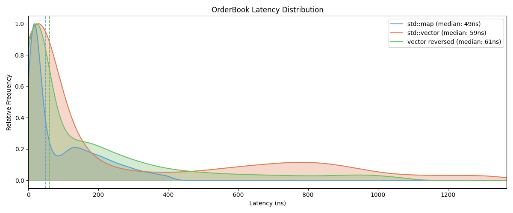

# Order Book Engine

High-performance C++20 limit order book designed for ultra-low latency trading systems.

- Sub-100ns adds and cancels at steady state (40ns / 30ns p50)
- O(1) order cancellation via direct pointer indexing
- MBO (Market-by-Order) matching engine with FIFO execution
- Benchmarked on 12.7M [Bybit BTCUSDT depth-200 L2][bybit-orderbook]
  events captured April 22, 2026

---

## Build, Test, and Benchmark

Requirements: CMake 3.15 or newer, Git, and a C++20 compiler.

Configure and build the project in Release mode:

```bash
cmake -S . -B build -DCMAKE_BUILD_TYPE=Release \
  -DBUILD_TESTS=ON -DBUILD_BENCHMARKS=ON
cmake --build build --parallel
```

Run the complete test suite:

```bash
ctest --test-dir build --output-on-failure
```

Run the order-book microbenchmarks:

```bash
taskset -c 0 ./build/benchmarks/benchmarks
```

Benchmark results depend on the CPU, compiler, build flags, system load, and
power-management settings. Use a Release build and record the environment when
comparing results.

---

## Performance (Linux Native / Ubuntu, GCC Release)

<!-- TODO: add hardware details when available, e.g.:
[CPU model] @ [X.X GHz], GCC [version], -O3 [-march=native],
performance governor.
-->

| Operation | p50 | p99 | p99.9 |
| --- | ---: | ---: | ---: |
| addOrder (no match, existing level) | 30.1 ns | 50.1 ns | 80.2 ns |
| addOrder (no match, new level) | 40.1 ns | 70.1 ns | 80.2 ns |
| addOrder (full match, one order) | 40.1 ns | 60.1 ns | 80.2 ns |
| cancelOrder (existing level) | 30.1 ns | 40.1 ns | 50.1 ns |
| sweep (8 levels) | 240.5 ns | 290.6 ns | 490.9 ns |
| sweep (64 levels) | 2.0 µs | 3.2 µs | 6.9 µs |
| sweep (256 levels) | 8.3 µs | 13.3 µs | 18.0 µs |
| sweep (1024 levels) | 32.9 µs | 45.9 µs | 50.2 µs |



Latency distributions for `std::map` and two sorted `std::vector` layouts,
replayed against the same 12.7M-event stream. Curves are clipped at p95.

---

## Core Design

### Matching Engine (MBO)

- Orders matched across all price levels (not just top-of-book)
- FIFO queue per price level ensures fair execution ordering
- Partial fills supported with remainder resting in-book

---

### Price Levels

- Intrusive doubly-linked list stored directly in `Order`
- Eliminates STL node allocation overhead
- O(1) insertion/removal within a price level

---

### Order Lookup (O(1) cancel)

- `unordered_map<OrderId, Order*>` → direct pointer access
- No traversal required for cancellation or modification
- Enables deterministic cancellation latency

---

### Modify / Cancel Semantics

- **Cancel:** O(1) removal via hash lookup + pointer unlink
- **Modify:** updates order quantity in-place while preserving:
  - original FIFO position
  - original price-time priority ordering
- No reinsertion required for size changes (avoids queue reshuffle)

---

### Memory Management

- Custom `OrderPool` and `PriceLevelPool` with free-list recycling
- In-place slot reuse avoids heap allocation on the hot path
- Capacity constructors pre-allocate every measured slot
- Separate order and level capacities avoid over-allocation at different scales
- Designed for steady-state zero-allocation behavior

---

### Design Tradeoff: `std::map` vs `std::vector`

`std::map` and two sorted `std::vector` price ladders were replayed against the
same Bybit stream. Reconstructing the observed depth-200 book produced:

| Event type | Count | Share |
| --- | ---: | ---: |
| Add | 5,024,749 | 39.5% |
| Update | 2,680,624 | 21.1% |
| Delete | 5,024,349 | 39.5% |
| **Total** | **12,729,722** | **100%** |

Counts follow [Bybit's delta rules][bybit-orderbook]:
a positive size inserts or updates a price level, while zero deletes it. The
initial snapshot levels count as adds; later snapshots reset the local book
without being counted as updates.

Adds and deletes make up 78.9% of the stream. That churn likely explains the
measured `std::map` advantage: sorted vectors shift elements on O(n) level
inserts and deletes, while maps perform them in O(log n). This conclusion is
specific to the measured workload.

`std::map` was retained as the production implementation because it provides:

- O(log n) insert/erase with no shifting cost
- support for arbitrary price ranges and tick sizes
- memory proportional to active price levels

---

## Order Types

- **`GOOD_TILL_CANCEL`:** Rests until cancelled or fully filled
- **`FILL_AND_KILL`:** Fills immediately and discards the remainder
- **`MARKET_ORDER`:** Fills at the best available prices
- **`FILL_OR_KILL`:** Fills completely and immediately or is cancelled
- **`POST_ONLY`:** Rests as liquidity or is rejected if it would cross

---

## Matching Logic

- Buy orders walk asks upward while price condition holds
- Sell orders walk bids downward
- Fully consumed levels are erased from active book
- Self-trade prevention cancels internal matches at source

---

## Benchmarking

- Cycle-accurate `rdtsc`/`rdtscp` harness fenced with `lfence`
- Benchmark process pinned to CPU 0 with `taskset -c 0`
- 100,000 iterations per measurement
- 5,000 untimed warm-up iterations before each measurement loop
- 100ms calibration window for cycle-to-nanosecond conversion
- One long-lived `OrderBook` reused for every sample in a scenario
- Per-sample setup and state restoration happen outside the timed region
- Book depth and pool occupancy remain steady throughout each scenario

[bybit-orderbook]: https://bybit-exchange.github.io/docs/v5/websocket/public/orderbook
